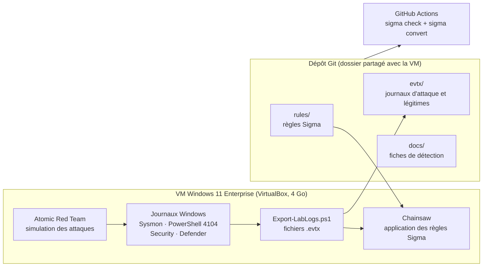

# Windows Detection Engineering Lab
 


 
Projet de **detection engineering** : simuler une chaîne d'attaque Windows réaliste, observer les traces qu'elle laisse dans les journaux, puis concevoir des règles **Sigma** qui la détectent, en prouvant qu'elles se déclenchent sur l'attaque **et** qu'elles restent silencieuses sur l'activité légitime.
 
Chaque règle est versionnée, documentée et validée automatiquement en intégration continue, selon une approche **detection-as-code**.
 
>  **Projet en cours.** Le lab et la chaîne d'outils sont opérationnels. Les tests des détections sont en cours : les résultats seront publiés dans ce README au fur et à mesure.
 
---
 
## Sommaire
 
- [Objectifs](#objectifs)
- [La chaîne d'attaque simulée](#la-chaîne-dattaque-simulée)
- [Architecture du lab](#architecture-du-lab)
- [Méthode](#méthode)
- [Structure du dépôt](#structure-du-dépôt)
- [Rejouer les tests](#rejouer-les-tests)
- [Résultats](#résultats)
- [Choix techniques](#choix-techniques)
- [Limites connues](#limites-connues)
- [Feuille de route](#feuille-de-route)
- [Avertissement](#avertissement)
---
 
## Objectifs
 
- Mettre en place une télémétrie Windows exploitable pour la détection (Sysmon, PowerShell, audit Windows).
- Simuler 5 techniques d'attaque MITRE ATT&CK de façon reproductible avec **Atomic Red Team**.
- Écrire pour chaque technique une ou plusieurs règles **Sigma** portables (convertibles vers Splunk, Elastic, Microsoft Sentinel...).
- **Mesurer** la qualité de chaque règle : détection de l'attaque, faux positifs sur activité légitime ciblée et sur usage normal du poste.
- Documenter les **limites et contournements** de chaque détection.
- Automatiser la validation et la conversion des règles avec **GitHub Actions**.
## La chaîne d'attaque simulée
 
Les 5 techniques forment un scénario cohérent, de l'exécution initiale au vol d'identifiants :
 
| # | Étape | Technique ATT&CK | Ce que fait l'attaquant | Règle(s) prévue(s) |
|---|---|---|---|---|---|
| 1 | Exécution | [T1059.001](https://attack.mitre.org/techniques/T1059/001/) PowerShell | Lance du PowerShell encodé en Base64 pour masquer sa commande | `proc_creation_win_powershell_encoded_cmd` |
| 2 | Transfert d'outil | [T1105](https://attack.mitre.org/techniques/T1105/) Ingress Tool Transfer | Télécharge un fichier avec `certutil.exe`, un binaire Windows légitime | `proc_creation_win_certutil_download` |
| 3 | Affaiblissement des défenses | [T1562.001](https://attack.mitre.org/techniques/T1562/001/) Disable or Modify Tools | Désactive la protection en temps réel de Microsoft Defender | `posh_ps_defender_disable_set_mppreference`<br>`win_defender_realtime_protection_disabled` | 
| 4 | Persistance | [T1053.005](https://attack.mitre.org/techniques/T1053/005/) Scheduled Task | Crée une tâche planifiée relancée à chaque ouverture de session | `proc_creation_win_schtasks_susp_creation`<br>`win_security_scheduled_task_created` | 
| 5 | Vol d'identifiants | [T1003.001](https://attack.mitre.org/techniques/T1003/001/) LSASS Memory | Copie la mémoire de LSASS via `comsvcs.dll` pour en extraire des secrets | `proc_creation_win_rundll32_comsvcs_minidump`<br>`proc_access_win_lsass_susp_access` | 
 
Pour les techniques 3 à 5, deux règles complémentaires sont prévues : l'une détecte **l'action** (une commande précise), l'autre **la conséquence ou le comportement** (indépendamment de l'outil utilisé), plus difficile à contourner.
 
## Architecture du lab
 
Le lab est volontairement léger : il tient sur un PC portable de 16 Go de RAM, sans SIEM.
 

 
| Composant | Rôle |
|---|---|
| **VirtualBox** + **Windows 11 Enterprise** (évaluation) | Machine cible isolée, réseau en NAT |
| **Sysmon** avec la configuration [sysmon-modular](https://github.com/olafhartong/sysmon-modular) | Création de processus, accès aux processus, fichiers, registre, réseau |
| **PowerShell Script Block Logging** | Contenu des scripts exécutés, y compris décodé (EventID 4104) |
| **Stratégie d'audit avancée** | Création de processus (4688) et de tâches planifiées (4698) |
| **[Atomic Red Team](https://github.com/redcanaryco/atomic-red-team)** | Tests d'attaque unitaires, reproductibles et réversibles |
| **[Chainsaw](https://github.com/WithSecureLabs/chainsaw)** | Application des règles Sigma directement sur les fichiers `.evtx` |
| **[sigma-cli](https://github.com/SigmaHQ/sigma-cli)** | Validation et conversion des règles |
| **GitHub Actions** | Intégration continue des règles |
 
## Méthode
 
Chaque technique suit le même cycle en 10 étapes :
 
| Étape | Action |
|---|---|
| A | Étudier la technique (page MITRE ATT&CK, exemples d'utilisation réels) |
| B | Vider les journaux de la VM (`Clear-LabLogs.ps1`) |
| C | Jouer l'attaque avec Atomic Red Team ou une commande manuelle, et noter l'heure |
| D | Exporter les journaux au format `.evtx` (`Export-LabLogs.ps1`) |
| E | Analyser les traces : EventID, champs et valeurs caractéristiques |
| F | Écrire la règle Sigma et la valider avec `sigma check` |
| G | Vérifier que la règle **détecte** l'attaque (Chainsaw) |
| H | Vérifier qu'elle **ne se déclenche pas** sur une activité légitime proche, et l'ajuster si besoin |
| I | Nettoyer la VM (`Invoke-AtomicTest -Cleanup`) |
| J | Documenter la détection dans une fiche et commiter |
 
## Structure du dépôt
 
```
detection-lab/
├── rules/windows/
│   ├── process_creation/      règles sur Sysmon 1 / Security 4688
│   ├── process_access/        règles sur Sysmon 10
│   ├── ps_script/             règles sur PowerShell 4104
│   └── builtin/               règles sur les journaux Security et Defender
├── evtx/
│   ├── attack/<technique>/    journaux enregistrés pendant chaque attaque
│   └── benign/<technique>/    journaux d'activité légitime (faux positifs)
├── docs/
│   ├── detections/            une fiche par technique
│   ├── attack-navigator/      couverture ATT&CK (layer.json + image)
│   └── img/                   captures d'écran
├── scripts/
│   ├── Clear-LabLogs.ps1      vide les journaux avant un test
│   ├── Export-LabLogs.ps1     exporte les journaux en .evtx dans le dépôt
│   ├── Test-Rules.ps1         applique toutes les règles sur un dossier d'evtx
│   └── attacks/               scripts de simulation des attaques
└── .github/workflows/
    └── sigma-ci.yml           validation et conversion automatiques
```
 
## Rejouer les tests
 
Les journaux de chaque test sont versionnés dans `evtx/`. Il n'est donc **pas nécessaire de recréer le lab** pour vérifier les résultats : Chainsaw suffit.
 
```powershell
# Appliquer toutes les règles sur les journaux d'une attaque
chainsaw hunt evtx/attack/T1105 -s rules --mapping mappings/sigma-event-logs-all.yml
 
# Vérifier l'absence de faux positifs sur l'activité légitime
chainsaw hunt evtx/benign -s rules --mapping mappings/sigma-event-logs-all.yml
```
 
Valider et convertir les règles avec sigma-cli :
 
```bash
pip install sigma-cli pySigma-validators-sigmahq pySigma-backend-splunk
sigma check rules/
sigma convert -t splunk --without-pipeline rules/
```
 
<details>
<summary><b>Recréer le lab de zéro</b></summary>
1. Créer une VM Windows 11 Enterprise (évaluation) dans VirtualBox : 4 Go de RAM, 2 vCPU, TPM 2.0, Secure Boot, réseau NAT, compte local uniquement.
2. Installer Sysmon avec la configuration sysmon-modular, publiée dans les [Releases](https://github.com/olafhartong/sysmon-modular/releases) du projet.
3. Activer le PowerShell Script Block Logging et l'audit des processus et des tâches planifiées.
4. Installer Atomic Red Team : module `invoke-atomicredteam` depuis la PowerShell Gallery, et dossier `atomics` depuis l'archive du dépôt.
5. Installer Chainsaw (le runtime Visual C++ x64 est requis).
6. Partager le dossier du dépôt avec la VM (lecteur `Z:`).
Points d'attention rencontrés :
- Sur un hôte Windows récent, la **sécurité basée sur la virtualisation (VBS)** et la **Plateforme d'ordinateur virtuel** monopolisent VT-x. VirtualBox bascule alors en mode Hyper-V (NEM), très lent, et Windows 11 reste sur un écran noir. Il faut les désactiver sur l'hôte.
- **AMSI** bloque l'installation d'Atomic Red Team par `IEX`, en mémoire : les exclusions de dossiers de Defender ne s'appliquent pas à ce cas.
</details>
## Résultats
 
> Section complétée au fur et à mesure des tests.
 
| Règle | Technique | Détection de l'attaque | Faux positifs (activité ciblée) | Faux positifs (usage normal) |
|---|---|---|---|---|
| PowerShell encodé | T1059.001 | — | — | — |
| Téléchargement via certutil | T1105 | — | — | — |
| Set-MpPreference | T1562.001 | — | — | — |
| Defender désactivé (5001) | T1562.001 | — | — | — |
| schtasks suspect | T1053.005 | — | — | — |
| Tâche planifiée créée (4698) | T1053.005 | — | — | — |
| comsvcs MiniDump | T1003.001 | — | — | — |
| Accès suspect à LSASS | T1003.001 | — | — | — |
 
**Couverture MITRE ATT&CK** : la heatmap [ATT&CK Navigator](https://mitre-attack.github.io/attack-navigator/) sera publiée dans `docs/attack-navigator/` à la fin des tests.
 
Le détail de chaque détection (télémétrie observée, logique de la règle, résultats, limites) se trouvera dans [`docs/detections/`](docs/detections/).
 
## Choix techniques
 
- **Sigma plutôt qu'un langage de requête propriétaire** : un format standard, lisible et versionnable, convertible vers la plupart des SIEM du marché. Les règles ne dépendent d'aucun outil.
- **Pas de SIEM** : avec 16 Go de RAM, un SIEM aurait consommé l'essentiel des ressources et du temps du projet. Chainsaw applique les règles directement sur les `.evtx`, ce qui garde l'effort sur la détection elle-même.
- **Journaux versionnés** : publier les `.evtx` de chaque test rend les résultats vérifiables par n'importe qui, sans recréer le lab.
- **Deux angles par technique quand c'est possible** : une règle sur l'action précise, une autre sur le comportement ou la conséquence, pour réduire les contournements.
- **Mesure systématique des faux positifs** : une règle qui alerte sur tout est inutile en SOC. Chaque règle est testée sur une activité légitime proche de l'attaque.
## Limites connues
 
- **Lab mono-poste** : pas d'Active Directory, donc pas de mouvement latéral ni d'attaques Kerberos.
- **Defender assoupli** : la protection contre les falsifications est désactivée et des exclusions de dossiers sont configurées, pour que les simulations puissent s'exécuter. En conditions réelles, l'attaquant devrait d'abord contourner ces protections, ce qui générerait des signaux supplémentaires.
- **Bruit de fond limité** : une VM de lab produit beaucoup moins d'activité qu'un poste de production. Les taux de faux positifs mesurés sont donc optimistes.
- **Attaques simulées** : Atomic Red Team reproduit des techniques, pas l'ensemble des variantes et des obfuscations utilisées par de vrais attaquants. Les contournements connus sont documentés dans chaque fiche.
## Feuille de route
 
- [ ] Tester et documenter les 5 techniques
- [ ] Mesurer les faux positifs sur une session d'usage normal
- [ ] Publier la heatmap ATT&CK Navigator
- [ ] Tester les règles sur des jeux de données publics ([EVTX-ATTACK-SAMPLES](https://github.com/sbousseaden/EVTX-ATTACK-SAMPLES), [Security-Datasets](https://github.com/OTRF/Security-Datasets))
- [ ] Ajouter des tests de détection automatisés en CI (Chainsaw sur `evtx/`)
- [ ] Intégrer un SIEM (Wazuh) pour valider les règles converties
- [ ] Étendre aux techniques Active Directory (Kerberoasting, DCSync) à partir de jeux de données publics
## Avertissement
 
Ce projet est réalisé à des fins **pédagogiques**, dans une machine virtuelle isolée prévue à cet effet. Les techniques d'attaque sont simulées avec des outils publics de test (Atomic Red Team) et des commandes inoffensives. Ne reproduisez ces tests que sur des systèmes dont vous êtes propriétaire ou pour lesquels vous disposez d'une autorisation explicite.
 
---
 
**Auteur** : [Michaël Adda](https://www.linkedin.com/in/michaël-adda) · Étudiant en dernière année, à la recherche d'un stage de fin d'études en cybersécurité (SOC / CERT / détection)
 
